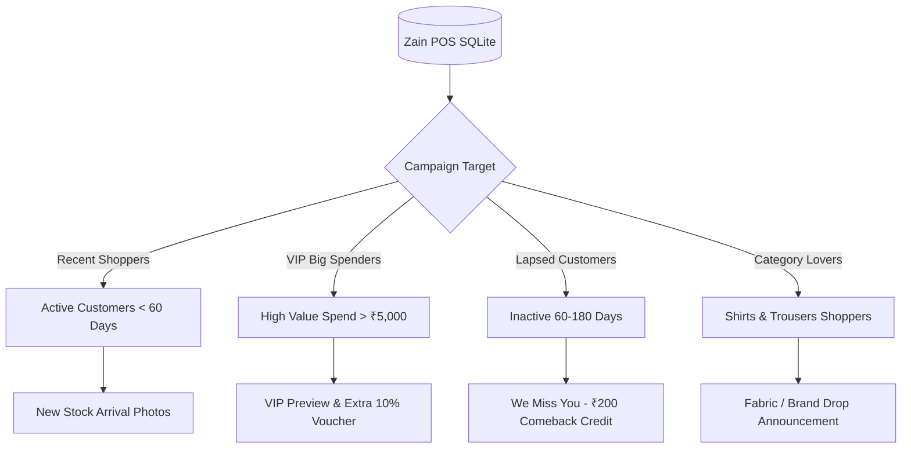

# WhatsApp Marketing & Customer Broadcast Campaign Plan
**Store**: Zain Gents Palace, Chirammal Tower, Raja Road, Nileshwar  
**System**: Zain POS v3 + Meta WhatsApp Cloud API  
**Status**: Ready for Implementation  

---

## 1. Executive Summary

Zain Gents Palace currently uses Meta WhatsApp Cloud API to deliver digital transactional receipts (`UTILITY`). This plan expands the integration into an active revenue-generation channel: **WhatsApp Broadcast Marketing (`MARKETING`)**.

### Primary Objectives:
1. **New Stock Announcements**: Instantly notify customers when fresh collections (Shirts, Trousers, Kurtas, Kidswear) arrive, complete with lookbook photos.
2. **Festival & Weekend Footfall**: Drive store footfall during Eid, Onam, festive seasons, and weekend sales using targeted discount vouchers.
3. **Dead Stock Liquidation**: Re-engage inactive customers with targeted seasonal clearance broadcasts.
4. **Zero Third-Party Subscriptions**: Leverage your existing permanent Meta System User token and POS SQLite database without paying monthly fees to external bulk-messaging software.

---

## 2. Meta WhatsApp Cloud API Marketing Framework

Unlike transactional utility templates, Meta categorizes promotional broadcasts under the **`MARKETING`** category.

### 2.1 Message Anatomy

```
┌─────────────────────────────────────────────────────────────┐
│  [IMAGE / VIDEO HEADER]                                     │
│  High-resolution photo of new arrival / festival poster     │
├─────────────────────────────────────────────────────────────┤
│  *ZAIN GENTS PALACE - NEW ARRIVALS*                         │
│                                                             │
│  Hello {{1}}! 🌟                                            │
│  Fresh new stock of {{2}} has just landed at our store!     │
│                                                             │
│  ✨ Highlights:                                             │
│  • {{3}}                                                    │
│  • Sizes: {{4}}                                             │
│  • Price starting from: ₹{{5}}                              │
│                                                             │
│  Visit our store this weekend to explore the full range!    │
├─────────────────────────────────────────────────────────────┤
│  Reply STOP to unsubscribe                                  │
├─────────────────────────────────────────────────────────────┤
│  [ 📍 View Store Location ]  --> Opens Google Maps          │
│  [ 📞 Call Store ]           --> Dials +91 90371 06449      │
│  [ 💬 Check My Size ]        --> Quick Reply to WhatsApp   │
└─────────────────────────────────────────────────────────────┘
```

### 2.2 Pricing & Cost Model (India - IN)

| Dimension | Transactional Receipts (`UTILITY`) | New Stock & Promotions (`MARKETING`) |
| :--- | :--- | :--- |
| **Meta Fee (India)** | ~₹0.35 – ₹0.46 / delivered message | ~₹0.80 – ₹0.90 / delivered message |
| **Taxes** | 18% GST (~₹0.08) | 18% GST (~₹0.16) |
| **Total Cost / Message** | **~₹0.54 INR** | **~₹1.00 INR** |
| **Billing Deducted From** | Meta Prepaid Balance | Meta Prepaid Balance |
| **Minimum Balance Alert** | Recommended ₹200 buffer | Recommended ₹500 buffer before campaign |

---

## 3. High-Impact Campaign Templates

### Campaign 1: New Stock Arrival (Rich Photo Broadcast)
- **Template Name**: `new_stock_arrival`
- **Category**: `MARKETING`
- **Header**: Image (Product photo or styled flat-lay)
- **Body**:
  ```text
  Hello {{1}}! 🌟
  Fresh arrivals at *ZAIN GENTS PALACE*! 
  Our new collection of {{2}} is now available in store.
  
  👕 Details: {{3}}
  📏 Sizes: {{4}}
  🏷️ Starting at: ₹{{5}}
  
  Visit us at Chirammal Tower, Raja Road, Nileshwar to grab yours before stock runs out!
  ```
- **Footer**: `Reply STOP to opt out`
- **Buttons**:
  - `URL`: **Visit Store** (`https://maps.google.com/?q=Zain+Gents+Palace+Nileshwar`)
  - `PHONE_NUMBER`: **Call Store** (`+919037106449`)
  - `QUICK_REPLY`: **Check Size & Color**

---

### Campaign 2: Festive & Seasonal Sale Discount
- **Template Name**: `festive_exclusive_offer`
- **Category**: `MARKETING`
- **Header**: Image (Sale banner / Offer creative)
- **Body**:
  ```text
  *Special Festive Treat for {{1}}!* 🎉
  
  Celebrate this season with *Zain Gents Palace*! Enjoy an exclusive {{2}}% OFF on your entire menswear and kidswear purchase.
  
  🏷️ Use Code: *{{3}}*
  ⏳ Valid Till: {{4}}
  
  Show this message at billing counter to claim your discount.
  ```
- **Footer**: `T&C Apply. Reply STOP to opt out`
- **Buttons**:
  - `URL`: **Directions to Store**
  - `PHONE_NUMBER`: **Call Us**

---

### Campaign 3: VIP Loyalty / Store Credit Balance Reminder
- **Template Name**: `vip_store_credit_update`
- **Category**: `UTILITY` or `MARKETING`
- **Header**: None or Store Logo
- **Body**:
  ```text
  Hello {{1}}, you have an active store credit balance of *₹{{2}}* at Zain Gents Palace.
  
  Your voucher code(s): {{3}}
  
  Drop by our Nileshwar showroom to redeem your credit on our brand-new collection!
  ```
- **Buttons**:
  - `URL`: **View Location**
  - `PHONE_NUMBER`: **Call Us**

---

## 4. Customer Segmentation Strategy (Zain POS Data)

Zain POS stores sales, items, customer mobile numbers, and purchase frequencies. Rather than blasting every customer with every broadcast, segmentation optimizes footfall while protecting sender reputation:



### Segmentation Groups:
1. **All Opted-In Customers**: Suitable for major seasonal clearances (Eid / Onam / New Year).
2. **VIP Top Spenders (Top 20%)**: Receive early-bird previews of premium brands 2 days before public release.
3. **Re-engagement (Inactive > 60 Days)**: Receive an automated "We Miss You" coupon to bring them back.
4. **Kidswear vs. Menswear Buyers**: Filtered by past purchase items so customers only get relevant offers.

---

## 5. Sender Reputation & Anti-Spam Guardrails

Meta strictly monitors phone number quality ratings (**Green = High, Yellow = Medium, Red = Low**). If too many customers block or report messages, Meta temporarily reduces sending limits.

### Safe Sending Principles:
1. **Mandatory Opt-Out**: Every marketing template includes `Reply STOP to opt out`. If a customer replies STOP, POS automatically sets `hasMarketingOptIn = false` and skips them in future broadcasts.
2. **Frequency Capping**: No individual customer should receive more than **1 marketing broadcast every 7 to 10 days**.
3. **Paced Throttling**: The POS batch runner dispatches messages in controlled batches (e.g., 25 messages per minute) rather than 500 at the exact same millisecond.
4. **Engaged Audience First**: Always broadcast first to customers who visited within the last 3 months to build high engagement scores on Meta.

---

## 6. Implementation Architecture in Zain POS

### Step 1: Register Marketing Template via Meta Cloud API
- Submit `new_stock_arrival` directly using our automated API script with header image handles and action buttons.

### Step 2: Dedicated POS Marketing Hub UI
- Create a dedicated screen in POS: **`src/pages/MarketingCampaigns.tsx`**.
- Features:
  - **Campaign Creator**: Select template, upload/pick product image, enter promotional text.
  - **Audience Selector**: Checkboxes for customer filters (All, VIPs, Inactive, Specific spend range).
  - **Cost Calculator**: Live calculation before sending (e.g., *"240 Recipients × ₹1.00 = ~₹240.00 estimated Meta cost"*).
  - **Live Dispatcher Progress Bar**: Shows `Sent (235/240)`, `Failed (0)`, and `Fallback to SMS (5)`.

### Step 3: Media Upload Pipeline
- Meta requires image headers to be uploaded via **Meta Resumable Media API** or passed as an accessible public URL.
- POS will let you pick any `.jpg`/`.png` file from your computer, upload it to Meta's media container, and attach it to the broadcast in one click.

---

## 7. Cost vs. Revenue Projections (ROI)

| Metric | Modest Campaign (250 Customers) | Full Campaign (600 Customers) |
| :--- | :--- | :--- |
| **Meta Delivery Cost** | ~₹250 INR | ~₹600 INR |
| **Expected Open Rate** | 90% (225 opens) | 90% (540 opens) |
| **In-Store Footfall Conversion** | 4% (10 store visits) | 4% (24 store visits) |
| **Average Bill Value** | ₹1,500 INR | ₹1,500 INR |
| **Generated Gross Revenue** | **₹15,000 INR** | **₹36,000 INR** |
| **Return on Ad Spend (ROAS)** | **60x Return** | **60x Return** |

---

## 8. Next Milestones

1. **Verify Utility Template**: Await final green tick on `tax_invoice` for billing operations.
2. **Submit Marketing Template**: Register `new_stock_arrival` on WABA `1286794870268878` with image header and buttons.
3. **Build Campaign Screen in Zain POS**: Implement the frontend campaign wizard and dispatch engine.

